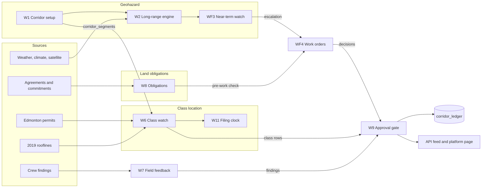

# n8n v2 workflows: setup and handoff

Last updated Nov 20, 2026, 23:30. Instance: `chlooood.app.n8n.cloud` (Cloud Pro). Read this before touching n8n.

**How we got here.** The hackathon version (Nov 14 to 15) was a geohazard dashboard with a solar and lease-income layer. The product (from Nov 16) is one record per pipeline kilometre with three modules: **geohazard**, **class_location** (early warning of class changes from building and development permits) and **land_obligations** (checking landowner and regulatory promises before work starts). Solar and the risk-score-to-dollars estimate are cut. The response-option costs in the class_location decision stay, and so does the decision `estimate` in the ledger; both are labelled placeholders.

## Next up, by person

| Who | Task | Notes |
| --- | --- | --- |
| Chloe (platform and frontend) | Push tonight's work: this doc, the `workflows/v2/` exports, the platform page key fix and the repo cleanup | Commands at the bottom |
| Chloe | After the PR merges: add the key header to `web/dashboard.html`'s POST to `/action` | Same pattern as `web/platform-app.js`. Needed before v2 WF4 is published |
| Chloe | Test the platform page key: open `dist/platform.html?api=https://chlooood.app.n8n.cloud/webhook/terracorridor-v2&key=<the key>` | Without the key, a decision should say "missing or wrong key". With it, a real decision lands in the ledger, so only test with a real one |
| Teammate 3 (backend) | Repo tasks 1 to 4 and 7 below | `src/` and `scripts/` are backend's folders |
| Teammate 4 | Repo task 5 (obligation placement) and finding real agreement text for W8 | Needs operator input; see findings |
| Teammate 1 (business lead) | Take the two land obligation questions into interviews | See "Findings worth taking to interviews" |
| Whoever runs switch day | Phase 2 below | Only once the hackathon demo is no longer needed |

## Ground rules

- **Hackathon workflows live in the "TerraCorridor Hackathon" folder. v2 lives in "TerraCorridor Revamped".** Only edit workflows named `v2 · ...` in the Revamped folder.
- **Shared tables, one writer at a time.** v2 uses the same Data Tables as the hackathon set, on purpose: one record per kilometre. A v2 workflow may write to a hackathon table only after its hackathon twin is unpublished. **No test writes to hackathon tables either** (corridor_watch, corridor_audit, corridor_work_orders, corridor_segments, corridor_predictions and the rest) until switch day.
- **Webhooks:** paths start with `terracorridor-v2/`. Every POST webhook uses Header Auth with the credential "TerraCorridor v2 webhook key", which expects the header `X-TerraCorridor-Key`. GET feeds stay open.
- **The repo is the source of truth.** Code nodes marked "GENERATED" come from `src/` via `scripts/`. Don't edit them in n8n; add a new node, and port it to `src/` later. WF4's Code nodes are hand-written hackathon code, so they may be changed.
- **Only a named person decides.** Every decision goes to v2 W9 `/decide`. Workflows draft, check and track; they never post decisions on their own.
- **Fail closed.** Missing or bad data becomes `unverified`, never `safe`, `clear` or `no change`. A blank obligation_status means unverified, never "no obligations".
- **No test rows in corridor_ledger.** It's a hash chain. Ask before any test that writes there, and only ever delete the newest row.
- **Every v2 workflow has an "About this workflow" sticky note**: what it does, trigger, reads, writes, next step. Don't rename nodes: Code nodes refer to other nodes by name.
- **After a workflow passes,** download it from n8n (⋯, Download) into `workflows/v2/` and commit it.

## Status

| Workflow | Module | State |
| --- | --- | --- |
| v2 · W6 Class location watch | class_location | **Published**, Mondays 06:00. Verified Nov 17: 22 no change, km 5.8 to 7.4 change possible |
| v2 · W11 Filing clock | class_location | **Published**, daily 07:00. Writes corridor_deadlines. Empty until W6 dates a change |
| v2 · W8 Land obligations | land_obligations | **Published** (webhook; extraction runs by hand). Refuses obligations without a km location |
| v2 · W9 Approval gate and evidence | all | **Published.** Has ledger race protection (re-read, 409) |
| v2 · W7 Field feedback | all | Race fix in (insert, re-read, remove loser, 409, and the saved finding is removed on a 409). Republish after the Nov 20 cleanup. Body field is `segment`, not `segment_id` |
| v2 · API Dashboard feed | all | **Published** at `terracorridor-v2/corridor`. Adds class_location and land_obligations; keeps option costs; drops solar and `config.money`. Its "Add class and obligations" node isn't in `src/` yet |
| v2 · WF4 Work orders and approvals | geohazard, land_obligations | **Rebuilt Nov 20, unpublished.** See "How WF4 works now". Only the tier override has run against the real W9; the rest was tested with simulated responses |
| v2 · W1, W2, WF3 | geohazard | Drafts, waiting for switch day |
| v2 · Email handoff | | Archived until approved orders need a real inbox |

## NGTL copies (Nov 22)

A separate set for NGTL lives in the n8n folder **"TerraCorridor NGTL"**. They were copied from the v2 workflows and write **only** to their own `ngtl_*` tables, so they never touch hackathon or v2 rows and don't wait for switch day.

| Workflow | ID | Notes |
| --- | --- | --- |
| NGTL · W1: Corridor Setup | `hj7z3Zm0fsYu71bn` | Reads `data/ngtl/ngtl-overpass.json` pinned at commit 5c96a30 from GitHub (no Overpass). Segmenter keeps all six lines (`workflows/ngtl/segment-route.js`, built by `scripts/make-ngtl-w1.js`). No offline fixture: if GitHub is unreachable the batch fails closed. Starts NGTL W2 |
| NGTL · W2: Long-Range Engine | `znZUJQb6r75IUavf` | Same engine; default corridor `ngtl-ab-osm` |
| NGTL · WF3 - Near-term watch | `fqZoknjxE98R0aQi` | DRY_RUN stays true: logs what it would draft, never calls WF4 |
| NGTL Seed - Hazard inputs | `e2KQq77pkzUkNdF1` | Manual only. Loads `ngtl_climate_cells` and the crossings on `ngtl_baselines` from `workflows/ngtl/NGTL Seed - Hazard inputs.json`. Run NGTL W2 after it |
| NGTL · API - Dashboard feed | `QHtI0E4XlA1YKSHb` | GET `terracorridor-ngtl/corridor`. Reads ngtl_* geohazard tables; class, obligations, work orders and build are the shared tables, read only |

Tables: ngtl_segments `xS9ClnujA4OcoBnp`, ngtl_sources `pKGFtBvarPgjHcM2`, ngtl_baselines `ZTaX6AEU5LB1jjMD`, ngtl_climate_cells `7rAbbtFPPAoZJ6jC`, ngtl_predictions `ZI6kdrxJeRhkLi0t`, ngtl_watch `H3ZGRfXhdpFzOzHw`, ngtl_audit `eRaYp9xSdyYLgGKW`.

Corridor `ngtl-ab-osm` is the 505 km of NGTL that OpenStreetMap names (6 lines, Fort Saskatchewan area north to Wandering River and Athabasca; 508 rows of 1 km). The rest of the 24,119 km system is "route not mapped" (see `data/ngtl/README.md`). The dashboard lists it in the corridor picker and reads its own feed (`api` in `data/corridors/catalog.json`).

### Getting NGTL scored (Nov 23)

W2 needs a climate cell for every segment, and Open-Meteo blocks n8n Cloud, so cells are fetched from a laptop as for Edmonton. Two NGTL-only differences in **NGTL · W2**, exported to `workflows/ngtl/NGTL · W2 - Long-Range Engine.json` (re-import that file after changing it; n8n versions are named and described):

- **`grid_cell_deg` = 0.5** (Edmonton stays 0.1). Open-Meteo's free tier allows about 5 cells a day per IP; at 0.1 degree NGTL needs 55 cells, at 0.5 degree 9 (`data/ngtl/cells.json`). A 0.5 degree cell is about 55 × 32 km here, close to the native grid of the three climate models, but every km in a cell shares its climate numbers.
- **Slower NDVI and elevation calls** (NDVI 5 per 3 s, elevation 10 per 3 s). At the old pace 441 of 508 segments came back "Try spacing your requests out" and stayed unverified.

Steps:

1. `node scripts/fetch-climate-cells.js --corridor ngtl-ab-osm` (busiest cells first, resumable; writes `data/ngtl/climate-cells.json`). With a paid Open-Meteo plan set `OPEN_METEO_API_KEY`; the key is sent only with the request, never stored.
2. `node scripts/make-seed-workflow.js --corridor ngtl-ab-osm`, commit, push.
3. In n8n, open **NGTL Seed - Hazard inputs**, Ctrl+A, Delete, ⋯ → Import from URL with the raw GitHub link to `workflows/ngtl/NGTL Seed - Hazard inputs.json`, save, Execute. It upserts `ngtl_climate_cells` and writes crossings to `ngtl_baselines`.
4. Execute **NGTL · W2**. Re-running also fills NDVI that was rate-limited the time before (W2 keeps the last good series).

Crossings (`data/ngtl/crossings.json`, from `node scripts/fetch-crossings.js <feed> data/ngtl/crossings.json`): 17 of 508 km cross a mapped waterway. The first fetch took river flow from the GloFAS cell nearest each crossing, which missed the main channel (Athabasca 0.2 and 1.4 m³/s, North Saskatchewan 6.2 m³/s). The script now takes the largest of the 3×3 cells around the crossing, and where a tributary and the main river share that cell the main river (longest named waterway) gets it. Until it is re-run and reseeded, treat river-crossing priority on NGTL as understated.

## How they connect



## How WF4 works now

- **/action needs the key.** A request without `by` gets a 400; there's no default name.
- **Every new order gets a land obligation check** (WF3 drafts, manager requests, redrafts) through `terracorridor-v2/obligation-check`. If notice is owed, the order is `awaiting_notice`. A failed check means `unverified`. An order with no check can't be approved.
- **Every decision goes to W9 first:** approve, reject and tier override as module "geohazard"; confirming landowner notice as "land_obligations". WF4 only changes its tables after W9 returns 200. W9's 400 or 409 goes straight back to the caller.
- **Notice flow:** awaiting_notice, then confirm_notice (a named person records when and how notice was given), then approve. `earliest_start` = when notice was given + the longest notice period. Approval before `earliest_start` is refused.
- **Tier overrides** write corridor_watch only after W9's 200. If a table write fails after W9 accepted, WF4 logs `override_not_applied`, `decision_not_applied` or `notice_not_applied` with the ledger seq.
- **Expiry:** a daily 05:30 job marks orders that waited 14 days for approval as `expired` (visible, logged to corridor_audit, not the ledger). Orders waiting on notice are exempt. `redraft_work_order` reopens one with a fresh check.
- **Hackathon-owned orders** (ones with an old resume URL, like WO-seg_0d3a534ba42860fc-MWHH0D7K) are refused for approve, reject and notice, and expiry skips them.
- **The Wait node is gone**, along with "Resolve decision" and "Release approval gate".
- **New corridor_work_orders columns:** obligation_status, earliest_start, obligation_json, inputs_hash, ledger_seq, ledger_hash, notice_given_at.

## Data tables

| Table | ID | Written by |
| --- | --- | --- |
| corridor_class | `FXVk5TLLPkkXEUHS` | W6 |
| corridor_class_baseline | `n1aDLVEitzHWHhxh` | Loaded from `data/tables/corridor_class_baseline.csv` |
| corridor_deadlines | created by W11 | W11 |
| corridor_obligations | `EUZF5nhieoE8ARzj` | W8 |
| corridor_findings | `dVuau6onaUzgJ6Yr` | W7 |
| corridor_ledger | `q6mDVRiZld0fztmn` | W9, W7 |
| corridor_segments, corridor_predictions, corridor_baselines, corridor_climate_cells, corridor_watch, corridor_work_orders, corridor_audit | in `workflows/wiring.json` | Hackathon writers until switch day, then v2 W1, W2, WF3, WF4 |

## Context block for the n8n Assistant

Paste this at the start of every Assistant conversation. One conversation per workflow keeps credit use down.

```
Project: TerraCorridor, one record per pipeline kilometre with three modules: geohazard (W1, W2, WF3), class_location (W6, W11) and land_obligations (W8, WF4). Every decision ends at v2 W9, which hash-chains it into corridor_ledger. Solar and the risk-score-to-dollars estimate are cut. The response-option costs in decision_json and the decision estimate stay; they're labelled placeholders.
Rules:
- Only edit workflows named "v2 · ..." in the TerraCorridor Revamped folder. Never touch the Hackathon folder.
- v2 shares the hackathon Data Tables. A v2 workflow may write to a hackathon table, including in tests, only after I've unpublished its hackathon twin.
- Webhook paths start with terracorridor-v2/. Every POST webhook uses Header Auth with the credential "TerraCorridor v2 webhook key". GET feeds stay open.
- Don't edit the logic in Code nodes marked GENERATED; add a new node instead. Don't rename nodes.
- Bad or missing data becomes "unverified", never "safe" or "no change".
- Never leave test rows in corridor_ledger. Before any test that writes there, show me the request and ask.
- Keep the "About this workflow" sticky note accurate. Show me the plan first. Ask before publishing.
```

## Phase 2: switch day

Only when the hackathon demo is no longer needed.

1. **By hand:** unpublish hackathon W2, WF3 and WF4, and stop the hackathon WF4's waiting executions (execution 55, waiting on WO-seg_0d3a534ba42860fc-MWHH0D7K since Nov 15) so no old approval link outlives it. The hackathon dashboard still loads, but its approve buttons stop working.
2. **Make sure `web/dashboard.html` sends the key** on `/action` (see "Next up").
3. **Tell the Assistant** "I've unpublished the hackathon W2, WF3 and WF4", then:
   - **W2:** confirm it reads corridor_climate_cells first (Open-Meteo blocks n8n Cloud), mark segments without climate data unverified, run once, report tier counts.
   - **WF3:** confirm it escalates to v2 WF4, keep DRY_RUN = true and MAX_DRAFTS_PER_RUN = 3, run once, report escalation_preview rows.
   - **WF4:** run the paths that were only simulated: approve, reject, confirm_notice, a "too early" refusal, redraft and the expiry job. Ask before each one that reaches /decide, and clean up test rows afterwards.
4. **Publish in this order:** WF4, then WF3, then W2.

## Phase 3: later

- **Calgary:** once the line is picked, run v2 W1 to add Calgary segments under a new corridor_id. Extending W6 to Calgary is a change to `scripts/make-platform-workflows.js` (permit field names), not an Assistant job.
- Never run v2 W1 on its own before switch day: it starts v2 W2, which would put two writers on the geohazard tables.

## Repo tasks

1. **Port the hand-added feed node** (backend). Move "Add class and obligations" from the v2 API feed into `src/dashboard-api.js` with a test, then regenerate. Until then, the export in `workflows/v2/` is the only copy.
2. **Ledger race protection in the generator** (backend). The live W9 and W7 re-read the ledger after writing and return 409 on a clash; this was added in n8n and isn't in `scripts/make-platform-workflows.js`, which still generates an upsert on `seq`. Port it for both.
3. **W9 `/platform` data_status** (backend). Show a missing or unexpected `data_status` as `unverified`, the way the API feed does.
4. **Stale deadlines** (backend). If a segment's plan_due is later cleared, its corridor_deadlines row stays. W11 should mark it cleared.
5. **Unplaced and corridor-wide obligations** (backend with Teammate 4). W8 refuses any obligation without a km location, so it can't store promises from documents with no km posts, even when the quote is perfect. Real Alberta agreements usually locate land by legal land description, and many promises cover the whole corridor. `src/obligations.js` needs corridor-wide obligations and a way to map land descriptions to km. Every work order on a corridor should show unplaced obligations as unverified, never hide them. corridor_obligations also needs a corridor column before it holds more than one pipeline's promises.
6. **W8 re-extraction keeps verification** (backend). Re-running extraction resets `verified` to false. Keep `verified` and `verified_by` on existing rows, and add a verify step that goes through W9.
7. **Remove the solar code** (backend). Solar is cut from the product, but `buildScore`, `moneyForSegment`, the W5 export, `scripts/fetch-solar.js`, the Seed - Solar inputs workflow and the dashboard's Build tab are still wired into `src/engine.js`, the tests, `scripts/build.js` and the BC seed scripts. Remove them in one change with the tests updated, then drop the corridor_build and corridor_build_config reads from the API feed.

## Findings worth taking to interviews

- **Public commitments tables leave out landowner agreements.** Operators publish regulatory commitments, but commitments made to landowners and Indigenous groups under contract aren't public. Ask: "Would you let us read your landowner agreements, and in what form?"
- **Placement is the hard part, not extraction.** W8 extracted 8 of 8 commitments with word-for-word quotes from a public NGTL table, but none had a km location. Ask: "How are your agreements located: km post, legal land description or parcel map?"
- **n8n Cloud reaches City of Edmonton open data** directly; W6 pulls permits live on every run.

## Gotchas

- Open-Meteo blocks n8n Cloud's shared IP (HTTP 429). W2 relies on the corridor_climate_cells cache, filled from a laptop with `scripts/fetch-climate-cells.js`.
- If corridor_class_baseline is ever emptied, W6 still runs but marks segments `lower_bound`. Reload it from `data/tables/corridor_class_baseline.csv`.
- Moving workflows into folders makes n8n save them, which changes their "last updated" date. The nodes don't change.
- The archived v2 · W9 draft and v2 · Email copy are intentionally archived. Don't restore the old W9: it would compete with the published one for the same webhook.
- The platform page keeps the n8n key in the browser after you open it once with `?key=`, and removes it from the address bar. Anyone with the key can post decisions, so share it only with the team.

## Pushing (Chloe)

```
cd C:\Users\chloe\terracorridor
git add -A docs workflows README.md .gitignore web/platform-app.js web/platform.html dist/platform.html deploy/platform.html
git commit -m "n8n v2 exports and handoff, platform page sends the webhook key, repo cleanup"
git push
```
