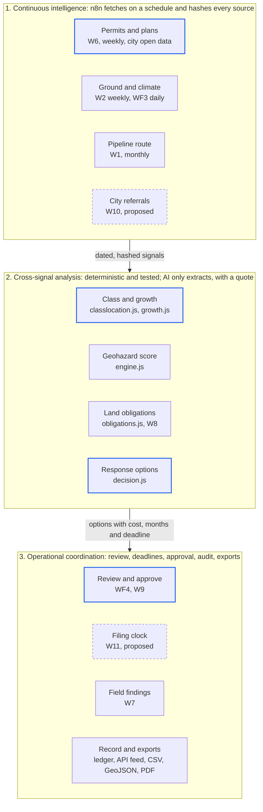

# TerraCorridor: Stage 1 strategic orientation

Nov 17, 2026. Stage 1 of the strategy reset, for team review. Live, commentable version: https://claude.ai/artifact/BxMeYwiVBcXiTnpsSv72FX

## Bottom line

**Recommendation: sell early warning of development near gas pipelines to the operator's integrity and regulatory team, in Canada first, and use the geohazard and land modules only where they change that one decision.** The problem worth paying for is that a class location change starts a six-month filing clock and can force a multi-million-dollar fix, and operators learn about it from houses that already exist. Our real edge is reading building and development permits before the houses go up, which no vendor in report 05 does.

The platform vision (environment, land use and infrastructure together) stays the long-term story, not the first product. Operators (62/100) and engineering consultants (61/100) score almost the same in the market matrix, so the beachhead is a lean, not a verdict. The first five interviews decide it.

Two facts change the next ten days. KickStart asks for a **letter of intent (LOI) by Nov 27, 11:59 PM**, so every interview should end with a pilot ask. And the event page says teams with an existing startup are welcome, so prior work is allowed if we say plainly what was built before and what was built during the event.

**How to read this doc.** Each claim carries a label: **[Confirmed]** has a source or a file in the repo, **[Inferred]** is reasoning from confirmed facts, **[Assumed]** is untested. **Sources used:** the repo at commit `89294ed`, the report 05 findings quoted in the strategy-reset brief, the KickStart 2026 event page, and public regulator pages. **Not read:** the Drive hub (00 to 07). Where this disagrees with the hub, it can only disagree with what the brief quotes from it.

## 1. Repository assessment

**The engine is real and tested; nothing has been validated with a user, and four of the newest n8n workflows have never run.** All 81 tests pass at commit `89294ed` [Confirmed]. Nothing below needs rebuilding. The gap is evidence, not code.

| Capability | Status | Evidence | What it still lacks |
| --- | --- | --- | --- |
| Geohazard engine (ground, crossings, wildfire, drought) | Implemented and tested; ran live | `src/engine.js`, 20 engine tests; W2 ran live on Nov 15 (`docs/JUDGE_PACK.md`) | Wildfire and drought scored on 1 of 23 km (humidity cache); thresholds are provisional; no user has seen it |
| Learned risk model | Planned | `ml/train.py` exists; no trained `model.json` in the repo | Not trained; would be US data applied to Alberta |
| Class location count and forecast | Implemented, not validated with users | `src/classlocation.js`, real City of Edmonton permits, rooflines and plans | CSA Z662 rules unverified (thresholds follow US 49 CFR 192.5); one roof counted as one home |
| Growth model and 2016 hindcast | Implemented and tested, one line | `src/growth.js`, 5 tests; 1,000 simulated futures to 2035 | Picks the right kilometre, but block-level timing is no better than a flat rate; Edmonton only |
| "Permits warned us 9 months ahead" backtest | Demonstration only | `docs/PLATFORM.md` | Restates an assumed lag. See the note below the table |
| Calgary backtest | Planned | No Calgary code or data in the repo | Everything in 06 section 3 |
| Decision and options module | Implemented, not validated | `src/decision.js`; includes the PHMSA integrity alternative | Every cost is a placeholder |
| "When to order pipe" signal | Implemented and tested | `orderSignal`, 1 test | Placeholder lead times; mostly moot in the US after the 2026 rule |
| Land obligations | Partial | `src/obligations.js`, CSV template, quote check | Example rows are invented; Pandell's export layout unseen; W8 extraction never run |
| Encroachment | Demonstration only | Crew findings inside 30 m | No feed (one-call, patrols or imagery) |
| Field feedback | Implemented, not run in n8n | `src/feedback.js`, W7 export | Never executed live |
| Approval ledger (hash-chained) | Implemented and tested | `src/ledger.js` | Lives in the browser unless W9 runs |
| Exports (CSV, GeoJSON, PDF) | Implemented and tested | `src/export.js` | Not opened by a Maximo, SAP or Esri user |
| Platform page (map, strip, inspector) | Implemented, demo on real data | `web/platform.html`, works offline | Not user-tested. GitHub Pages publishes `deploy/` (katiescase.github.io/terracorridor), so the live site's version needs checking |
| BC Coquihalla corridor | Partial | `docs/BC_CORRIDOR.md` | Seed workflow not run live |

**One correction to the hub [Confirmed, repo].** The brief says the 9-month lag from permit to occupied home is assumed. The time from building permit to move-in is now measured across the whole city of Edmonton: a median of 8.5 months over 8,231 homes (commit `89294ed`). What is still assumed is the lead time on a specific corridor's class change, because the older class-change backtest has not been rerun with the measured lag. The Calgary backtest should measure it directly.

### n8n workflows

| Workflow | In repo | Ran live? (repo evidence) | Keep for the beachhead? |
| --- | --- | --- | --- |
| W1 Corridor setup | Yes | Yes, before Nov 15 | Yes, to cut any new line into kilometres |
| W2 Long-range geohazard engine | Yes | Yes, Nov 15 | Supporting |
| WF3 Near-term weather watch | Yes | Imported; dry run unverified (Open-Meteo blocks n8n Cloud) | Optional |
| WF4 Work orders and approvals | Yes | API call passed Nov 15 | Yes, as the review step |
| W5 Solar build layer | Yes | Retired from the page | No |
| API dashboard feed | Yes | Yes | Yes |
| Email handoff | Yes | Tested in the repo only | Optional |
| Seeds (forecast, hazard, solar, Coquihalla) | Yes | Partly | Only as needed |
| W6 Class location watch | Yes, generated | Never run | **Yes, the core feed** |
| W7 Field feedback | Yes, generated | Never run | Later |
| W8 Land obligations | Yes, generated | Never run | Yes, if the demo uses an obligation |
| W9 Approval gate and evidence | Yes, generated | Never run | Yes |
| W10 Referral intake, W11 Filing clock | No (proposed in 07, per the brief) | No | Decide after interviews |

**Check on the live instance** (the judge pack names `chlooood.app.n8n.cloud`; it was not visible for this review):

- [ ] Plan and expiry: is it really Cloud Pro now? The team said earlier it was a trial it would not pay for.
- [ ] Which workflows are active, and the date of each one's last successful run.
- [ ] Whether the five data tables for W6 to W9 exist (column list in `docs/PLATFORM.md`).
- [ ] Which AI credential W2, WF4 and W8 use. The repo disagrees with itself: Gemini via an AI Studio key, or n8n gateway credits.
- [ ] Executions used this month against the plan's limit.
- [ ] Live webhook URLs for `/corridor`, `/action`, `/decide`, `/finding`.
- [ ] Whether the live W5 still differs from the repo (it did on Nov 15).

## 2. The core problem

**Recommended core problem: operators learn too late that development is about to change the safety class of their pipe. A regulator's deadline then forces a rushed, expensive choice between lowering pressure, testing, assessing or replacing pipe.** That is hypothesis B made specific, with D (systems describe today) as how we solve it. A and C are real, but nobody has a budget line for them.

*Class location* means the safety class of a stretch of gas pipeline, set by how many homes sit within 200 m of it over a 1.6 km window. More homes means a higher class, and a higher class can mean lower pressure, a test or new pipe.

| Hypothesis | How expensive | How often | Who cares most | Budget? | How well solved now | Fit with our tech |
| --- | --- | --- | --- | --- | --- | --- |
| **A. Fragmented information** | Hours lost cross-checking systems [Assumed]; no public cost figure | Daily, low stakes | Land and GIS analysts | No line item [Inferred] | Partly: Irth and Pandell bundle land, one-call and geohazards [Confirmed, 05] | Medium; we would be a fourth screen |
| **B. Changes detected too late** | Class-driven replacement costs US operators $200–300M a year for under 75 miles [Confirmed, 05]; a missed 6-month CER plan is a compliance finding [Inferred] | Rare per operator: 78–118 US miles change class a year [Confirmed, 05] | Integrity and regulatory engineers | Yes: integrity and compliance budgets exist [Inferred] | Annual class surveys, patrols, imagery counts (Orbital Eye, Ecopia, GDM); all see homes after they exist [Confirmed, 05] | **High**: permits lead move-in by a median 8.5 months in Edmonton [Confirmed, repo]; no vendor uses permits [Confirmed, 05] |
| **C. Costly coordination across engineering, land, planning, compliance** | Real but unmeasured [Assumed] | Every project that breaks ground | Project and land managers | Spread across departments [Inferred] | Email, spreadsheets, Irth workflows | Medium: our ledger and approval gate fit, but incumbents own this |
| **D. Systems describe today, not what is coming** | A framing, not a cost on its own | n/a | Strategy and planning staff | Rarely funded alone [Inferred] | Weakly: GDM says forecasting tools are "in development" [Confirmed, 05] | High, as the way we solve B |

**Why not "fragmentation".** No source shows anyone paying to fix it, and the overlap of the four risks on one stretch is inferred in 05, not shown. Leading with it puts us head to head with Irth (owned by TPG since 2025) and Pandell.

**How the other capabilities serve B.**

- **Geohazards** change the answer, not the question. The same class change on unstable ground makes a pressure test or a dig riskier, which can tip the cheapest response.
- **Land obligations** rule responses in or out. A replacement or test that breaks ground triggers the promises made to that landowner (timing, access, notice).
- **Encroachment** is the same signal at a smaller scale: digging inside the 30 m prescribed area.
- **The ledger** is what a regulator asks for: who decided, when, on what evidence.

**What weakens B, honestly.**

- The US rule of Mar 16, 2026 lets many operators keep pressure by meeting integrity conditions instead of replacing pipe [Confirmed, 05]. So the money at stake in the US shrinks, and the pitch must be "time to choose the cheapest response", not "order pipe early".
- Operators may already hear about development through municipal referrals. In Alberta, municipalities must send applications near sour gas facilities to the regulator, which received more than 2,000 such referrals a year as of 2013 ([AER Bulletin 2013-03](https://www.aer.ca/about-aer/media-centre/bulletins/aer-bulletin-2013-03)) [Confirmed]. Whether operators of sweet gas transmission lines get referrals routinely is not known [Assumed]. This is the single most important thing to ask in interviews.
- Frequency is low per operator. A tool that matters twice a year must be cheap to keep, or bundled with something used weekly (referrals, digging near the line).

## 3. Three positioning alternatives

**The lean is option 1, with option 2 ready to swap in if interviews show referrals are where the hours go.** Option 3 is a channel, not a product, and can run alongside either.

| | 1. Class change early warning | 2. Development referral copilot | 3. Corridor change screening for consultants |
| --- | --- | --- | --- |
| **For** | Integrity and regulatory engineers at gas transmission operators (CER and AER regulated) | Land, damage prevention and integrity staff who answer municipal referrals near the pipe | Geohazard and pipeline integrity consultants (BGC, Stantec, WSP) who assess corridors for operators |
| **Promise** | "Know which kilometres will change class 1–3 years ahead, and have the six-month plan half drafted when they do." | "Every referral the city sends is mapped to your pipe in minutes, with class, setback and landowner promises flagged and a reply drafted." | "A corridor screening report (development, ground, obligations) per kilometre, in a day instead of a week." |
| **What already runs** | Class location module, growth model, decision module, W6, W9, filing PDF | Map, class count, obligations check, ledger; needs referral reading (W10) | All modules plus the exports |
| **Weekly use?** | No: watch list monthly, decisions a few times a year | Yes, if referrals are steady | Per project |
| **Biggest risk** | Low frequency; buyer may say annual surveys are enough | Referrals may be rare, or arrive as scanned PDFs we can't read reliably | Consultants may see us as a competitor (BGC sells Cambio) |
| **What it makes us drop** | Geohazard as a headline, solar, B2G, the "4-in-1" story | Long-range forecasting as the headline, the 2035 outlook, geohazard | Our own workflow and approval layer; direct operator sales for now |

**The mission still fits.** Each option starts with development near a pipe because that is where a deadline creates a budget. Climate and ground hazards enter as the second signal that changes the decision. Option 1 can grow into "what is changing around this asset, and what must we decide" for any linear asset, which is the platform vision, earned one buyer at a time.

## 4. Market comparison

**Operators score 62/100 and consultants 61, too close to call. Municipalities (52) and other linear infrastructure (42) are later markets.** Scores are 1 (bad for us) to 5 (good for us) and are judgement from the evidence above [Inferred]. Change any score and the total moves by weight × change ÷ 5.

| Criterion | Weight | Pipeline operators | Municipalities and provinces | Engineering consultants | Other linear infrastructure |
| --- | --- | --- | --- | --- | --- |
| Problem severity | 12 | 4 | 2 | 3 | 2 |
| Frequency of use | 8 | 2 | 4 | 3 | 2 |
| Willingness to pay | 12 | 4 | 1 | 3 | 2 |
| Customer accessibility (for us, in 10 days) | 10 | 2 | 4 | 3 | 2 |
| Weakness of existing alternatives | 6 | 3 | 3 | 2 | 3 |
| Purchasing simplicity | 8 | 1 | 1 | 3 | 2 |
| Data availability | 8 | 3 | 5 | 3 | 2 |
| MVP fit (what already runs) | 12 | 5 | 2 | 4 | 1 |
| Time to first pilot | 10 | 2 | 2 | 3 | 1 |
| Market size | 6 | 4 | 2 | 2 | 4 |
| Expansion potential | 4 | 4 | 3 | 3 | 4 |
| Low liability and regulatory exposure | 4 | 2 | 4 | 4 | 3 |
| **Weighted total (out of 100)** | 100 | **62** | **52** | **61** | **42** |

**Counts we can verify** [Confirmed]:

- The CER regulates [126 companies and 73,000 km of pipeline](https://www.cer-rec.gc.ca/en/about/news-room/fact-sheets/canada-energy-regulator-numbers.html) (page dated May 17, 2023).
- [955 companies operated AER-regulated pipelines in 2025](https://aer.ca/data-and-performance-reports/industry-performance/pipeline-performance/pipeline-inventory); 77 of them run over 80% of Alberta's pipelines.
- PHMSA received [1,451 gas transmission and gathering annual reports for 2024](https://www.phmsa.dot.gov/data-and-statistics/pipeline/annual-report-mileage-natural-gas-transmission-gathering-systems), covering 300,851 miles of transmission pipe.

**Governments: two different duties.** A municipality's duty is to approve development safely: setbacks, and in Alberta, sending applications near sour gas facilities to the regulator ([Subdivision and Development Regulation, s.10](https://rmalberta.com/resolutions/9-19f-setback-referrals-for-development-near-sour-gas-facilities-in-crown-land-areas/)) [Confirmed]. Class location filings are the operator's duty, not the city's [Confirmed, 05]. So a city would pay for faster, safer referral review, not for our class forecast [Inferred]. Procurement usually means a quote process or tender and a budget cycle, months not days [Assumed; confirm with one planner]. Cities are a good **data partner and interview source** now, and a customer later.

**Consultants: all three roles at once.** BGC sells Cambio, so for geohazards they are a **competitor**. For development forecasting, nobody in 05 does it, so a consultant could be a **channel** (they run the class surveys and assessments for operators) or a **customer** (a tool that makes their reports faster) [Inferred]. Ask each consultant which role they see.

**Other linear infrastructure: what transfers.**

| Part | Transfers to water, power, rail? | Needs new |
| --- | --- | --- |
| Kilometre segmentation, map, ledger, exports, n8n plumbing | Yes, as is | Nothing |
| Permit-based growth forecast | Yes, the forecast itself | A reason to care: no class-location rule drives water or power lines |
| Geohazard engine | Mostly | New thresholds per asset type and validation |
| Class location rules and filing clock | No | Each sector's own rules |
| Land obligations | Partly | Each sector's agreement formats |

The technology transfers; the reason to buy does not [Inferred]. That is why it scores last today.

## 5. Preliminary recommendation

**Beachhead: mid-size Alberta-based gas transmission and midstream operators, one pipeline at a time, reached directly and through the consultants who already survey their lines.** Mid-size because the largest operators (TC Energy, Enbridge) have in-house GIS teams and long security reviews [Assumed], and the smallest have few lines near growing towns [Inferred].

| Stage | Who | What they get | Why this order |
| --- | --- | --- | --- |
| Beachhead (now to mid 2027) | Integrity and regulatory teams at 3–5 Alberta and CER-regulated operators near growing municipalities | Class change watch list, filing clock, drafted plan, decision record | A legal deadline creates a budget; our permit signal is unique; the code already runs |
| Second market (2027–28) | Engineering consultants as a channel, then US gas transmission operators | The same engine inside consultant reports; US version with the integrity alternative built in | Consultants reach many operators at once; the US market is larger but the 2026 rule changes what is at stake |
| Long-term platform (2028 on) | Any owner of a long asset crossing changing land: water mains, transmission lines, rail; municipalities on the referral side | "What is changing around this asset and what must we decide": development, ground and climate, land terms, one record | This is the mission. It needs the decision record and the trust earned in the beachhead |

**How sure is this?** Low to medium. The matrix is close between operators and consultants. The biggest unknown is whether operators already learn about development early through referrals.

**What would change it:**

- 3 or more of the first 5 operator interviews say referrals reach them early and reliably → switch to option 2 (referral copilot), or drop operators and go to consultants.
- A consultant offers to try it on a live client corridor → consultants become the beachhead.
- The Calgary backtest shows permits lead class changes by under 6 months → the early-warning claim weakens; lead with the filing package and decision record instead.
- A municipal planner says they would pay to see pipeline implications of applications → a B2G track opens, but only as a second product.

**Market size frame (numbers in Stage 2).** Theoretical: every pipeline operator in Canada and the US (counts in section 4). Serviceable: operators of gas lines that run near growing towns. Achievable early customers: 1 to 3 paid pilots in year one. Municipalities and kilometres of line are not counted as customers.

## 6. Product architecture

**Almost everything in the three layers already exists. The only new pieces are a filing clock (W11) and, if interviews justify it, a referral reader (W10).** The rule that keeps it credible: anything that decides a class, a deadline or a cost is plain, tested code. AI only summarizes or pulls text out of a document, and every extracted line carries the exact quote it came from.

Blue outline: the beachhead path. Dashed: proposed, not built yet.

The highlighted path is the beachhead: permits come in weekly, the class and growth model finds the kilometre that will change, the options module prices the responses, and a named person approves one before the filing clock runs out. Ground and land terms join at the analysis layer, where they change which response wins. Crew findings (W7) feed back into the next count.

**Where the 07 proposals fit (as the brief describes them):** W6 extended to Calgary is layer 1 and also feeds the backtest. W8 wired into WF4 is layer 2 into layer 3, so every work order lists the promises on that kilometre. W11 is layer 3. W10 is layer 1, and only worth building if referrals turn out to be real work.

## 7. The five most consequential decisions

**Decide the first two by end of Nov 18. The other three follow from them.**

| # | Decision | Options | Lean | Decided by |
| --- | --- | --- | --- | --- |
| 1 | Who is the first customer? | Operator integrity and regulatory teams · consultants · municipal planners | Operators as the user, consultants as a door to them. Interview all three; commit to the one that signs a pilot letter | Nov 18, revisited Nov 25 with interview evidence |
| 2 | What one job does the product do? | Forecast class changes · read incoming referrals · assemble the 6-month filing | Forecast plus filing clock. Switch to referrals if 3 of the first 5 operator calls say that is where the hours go | Nov 18 default, interview check by Nov 23 |
| 3 | Which regulator first? | Canada (CER and AER) · US (PHMSA) | Canada. Six-month clock, Calgary network, free Alberta data. The US 2026 rule removes much of the pipe-replacement pain | Nov 18 |
| 4 | What are geohazards and land obligations for in the MVP? | Equal pillars · supporting signals · cut | Supporting signals: each appears once in the demo, at the moment it changes the decision | Nov 18 |
| 5 | What pilot letter do we ask for by Nov 27, and from whom? | Non-binding letter to try a free 60-day pilot on one line · letter of interest only · none | A non-binding pilot letter from a named person who can actually agree to it, in whichever segment says yes first. Never a drafted or invented letter. If none comes, say so and show the conversations | Ask in every call from Nov 19 |

**Not on the list, deliberately:** the brand, the platform name, a new UI, more modules. None of these change what a customer would sign.

## 8. Hard questions, answered honestly

**Short version: lead with the one thing nobody else does (reading permits before houses exist), stop selling the combination, and treat n8n as plumbing, not a feature.**

| Question | Honest answer |
| --- | --- |
| Do Irth, Pandell, Cambio and GDM already cover a combined platform? | They cover most of the parts: one-call, land and geohazards are bundled at Irth; GDM watches class location. None in 05 uses permits [Confirmed, 05]. No source shows a buyer asking for the four risks together [Confirmed, 05]. The gap is the forward signal, not the combination [Inferred]. |
| Would governments pay for predictive monitoring? How long? | Not for operator compliance; that duty is the operator's. Possibly for faster referral review. Procurement is months, not days [Assumed]. Not a KickStart-week customer. |
| Are geohazards and land obligations essential to the first decision? | Probably context, not essential [Inferred]. They earn a place where they change the answer (a test on unstable ground, a promise to a landowner that blocks a dig). Ask in every land and integrity call. |
| Is a consultant channel more realistic than selling direct? | For reach, maybe: consultants run class surveys for many operators and buy tools faster [Inferred]. For geohazards they compete with us (BGC Cambio). Test both doors this week. |
| Is one backtest enough to support a decision? | Enough for a watch list ("look at km 5–6 this year"). Not enough to commit money ("order pipe now"). The kilometre-level call was right in the one hindcast; block-level timing was not better than chance [Confirmed, repo]. Calgary is the second test. |
| Are we serving too many customers? | Yes. Four segments and five modules for a team with no interviews. One buyer, one job, one demo. |
| Is there a narrower use case that leads somewhere bigger? | Yes, two: automating referral review, or assembling the six-month filing package. Both are weekly, concrete jobs that pull the forecast in later. Interviews choose between them. |
| Is n8n creating real value, or automation for show? | Real where it replaces a person on a schedule: the weekly permit pull (W6), the filing clock (W11), routing a review to a named approver (WF4, W9). For show: AI summaries of numbers we already compute. Demo one workflow that saves a real person real hours. |

### Riskiest assumptions and a cheap test for each, before Nov 26

| Assumption (most important, least tested first) | Cheap experiment | Owner role | Passes if |
| --- | --- | --- | --- |
| Operators learn about class changes late, not early through referrals or annual surveys | Ask 5 operator staff: "How did you find out about the last new subdivision near your line? How long before people moved in?" | Discovery lead | 3 of 5 found out after building started |
| Someone with a budget feels the CER six-month deadline as pain | Ask the same 5, plus search the CER's public filing database (REGDOCS) for class location filings to count how many happen a year | Discovery lead; tech lead for the search | 2 of 5 can describe a scramble, or filings show more than a handful a year |
| Permits lead the class change by enough months to matter | Calgary backtest: permit date vs. completion date on lines near new suburbs | Tech lead | Median lead of 6 months or more |
| Someone will sign a pilot letter | End every call with the ask: "Would you try this free on one line for 60 days?" | Everyone | 1 signed, real letter by Nov 27 |
| Land promises actually block or change a response | Ask 2 land agents for one real example (no names needed) | Business lead | 1 of 2 has an example |
| Cities would use pipeline-aware referral review | Ask 3 planners what they do when an application sits near a pipeline | Business lead | 2 of 3 say it is slow or manual |

## 9. KickStart eligibility

**Prior work is allowed: the [KickStart 2026 page](https://www.ubcbiztech.com/events/kickstart-2026) says teams that already have a startup can use the week to take it further [Confirmed].** It also says the event is for UBC students and recent graduates with "an idea, early product, or problem". The page publishes no rule that work must start at the event, no team-size limit and no judging criteria [Confirmed, read Nov 17].

| Date (2026) | What the page says is due |
| --- | --- |
| Nov 19, 11:59 PM PT | Application deadline |
| Nov 26, evening | Kickoff, in person, downtown Vancouver |
| Nov 27, 11:59 PM | **Deliverable: letter of intent (LOI)**, after a remote customer validation day |
| Nov 28 or 29, 6:00 PM | **Deliverable: MVP.** The page lists it under both days; confirm which |
| Nov 28, 6:00–7:00 PM | Public showcase |
| Nov 30, 5:00 PM | Devpost submission due |
| Nov 30, evening | Final pitch, judging, awards (UBC Sauder) |

**How to present prior work honestly:**

- Say when it started. The repo history shows work from the UBC eProjects x n8n buildathon onward; put the date and a one-line "before KickStart" list on the Devpost page.
- Separate before and during. A two-column slide: built before (engine, class module, map, n8n workflows) and done during KickStart (interviews, the LOI, the Calgary result, the demo built for one buyer).
- Say AI helped. The repo already credits Claude; keep that line in the Devpost text.
- Label data. Real public data (City of Edmonton, Calgary, AER) apart from illustrative rows (land obligations, costs).
- **The LOI must be real.** The team's honesty rules already forbid invented letters. If no one signs by Nov 27, submit what is true: who you spoke to and what they said yes or no to.

**Check with the organizers** (KickStart Director, michele@ubcbiztech.com): team-size limit (2025 allowed 2 to 4 per [Devpost](https://kickstart-2025.devpost.com/), so check whether Chloe is one of the four or a fifth), the MVP deadline day, what counts as an LOI, and whether the 2025 age limit (16 to 24) still applies.

## 10. Questions before Stage 2

1. **Contacts.** How many people at pipeline operators could each of us get on a 15-minute call by Nov 21, and in which roles (integrity, regulatory, land)? Company types are enough, no names. This decides the beachhead more than any score.
2. **The pilot letter.** Who is the most likely person to sign a real, non-binding pilot letter by Nov 27? Is one from an individual engineer or planner acceptable, or must it come from someone with authority to start a pilot?
3. **n8n.** Whose instance is it (the judge pack names `chlooood.app.n8n.cloud`), is it on Cloud Pro or still a trial, and until when? This decides whether the demo can run live.
4. **The mission in the pitch.** Lead with the compliance problem and show resilience and climate as where the company goes next, rather than the headline?
5. **The hub.** Does anything in 05, 06 section 3 or 07 contradict this doc? In particular, what do 07's W10 and W11 do, and does 05 name the 14 corridors' operators?

## Sources

Read on Nov 17, 2026:

- This repo at commit `89294ed`: `README.md`, `docs/PLATFORM.md`, `docs/DISCLOSURES.md`, `docs/JUDGE_PACK.md`, `docs/BC_CORRIDOR.md`, `workflows/README.md`, `src/`, `test/`
- Report 05 findings as quoted in the strategy-reset brief (the report itself was not read)
- [KickStart 2026 event page](https://www.ubcbiztech.com/events/kickstart-2026) and [KickStart 2025 Devpost](https://kickstart-2025.devpost.com/)
- [CER by the numbers](https://www.cer-rec.gc.ca/en/about/news-room/fact-sheets/canada-energy-regulator-numbers.html)
- [AER pipeline inventory](https://aer.ca/data-and-performance-reports/industry-performance/pipeline-performance/pipeline-inventory)
- [PHMSA gas transmission and gathering mileage](https://www.phmsa.dot.gov/data-and-statistics/pipeline/annual-report-mileage-natural-gas-transmission-gathering-systems)
- [AER Bulletin 2013-03 on mandated referrals](https://www.aer.ca/about-aer/media-centre/bulletins/aer-bulletin-2013-03)
- [RMA resolution 9-19F on setback referrals](https://rmalberta.com/resolutions/9-19f-setback-referrals-for-development-near-sour-gas-facilities-in-crown-land-areas/)

Written with Claude (Anthropic).
